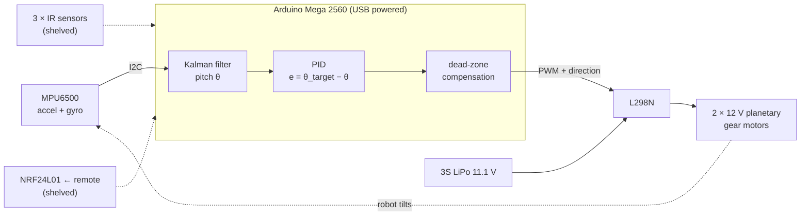

# NIDS: Two-Wheeled Self-Balancing Robot

A two-wheeled inverted-pendulum robot built on an Arduino Mega. An MPU6500
IMU feeds a Kalman filter for pitch, and a PID loop drives two 12 V planetary
gear motors through an L298N to keep the robot upright. The first design also
had IR line following and a handheld NRF24L01 remote with an IR/manual mode
switch. Those parts are built and their code is archived here, but they're on
hold while the balancing gets tuned.

Built by **Team NIDS** at IIT Bombay as an ITSP project in mechatronics,
May-Aug 2026.

> **Status (last update 18 Aug 2026):** the IMU readings and a direct motor
> test work. The motors weren't yet responding under PID control, and the
> motor-direction fix had been proposed but not confirmed. Chassis assembly
> and any balancing result aren't recorded yet. See the
> [progress log](docs/progress-log.md).

## How it works



1. **Sense.** FastIMU reads the MPU6500 over I2C at 400 kHz. Pitch is
   computed from the accelerometer (`atan2`) and fused with the gyro rate in a
   two-state Kalman filter (angle and gyro bias).
2. **Decide.** PID on the pitch error, with the integral clamped to ±5000.
   Beyond ±17.5° the robot drives at full power back towards upright, and
   beyond ±35° it counts as fallen and stops.
3. **Act.** The motors have no encoders and don't move below a certain PWM,
   so commands are remapped above that threshold. You measure it with a
   bench sketch; it hasn't been measured on this build yet. Both wheels get
   the same command, since the robot only balances and doesn't steer.

The control design follows a linearised Euler-Lagrange model. It was tuned in
MATLAB to Kp = 450.47, Ki = 800.91, Kd = 100, and those gains are reproduced
and examined in [docs/simulation.md](docs/simulation.md).

## Hardware

| | |
|---|---|
| Controller | Arduino Mega 2560 |
| IMU | MPU6500 (I2C, 0x68) |
| Motor driver | L298N dual H-bridge |
| Motors | 2 × 12 V DC planetary gear motor, no encoder |
| Wheels | 100 mm × 44 mm |
| Power | 3S LiPo 11.1 V for the motors; USB for the logic |
| Chassis | 3 × 230 × 100 × 6 mm laser-cut acrylic plates on M6 rods |
| Remote (shelved) | Arduino Nano, KY-023 joystick, NRF24L01+PA+LNA, 9 V; custom EasyEDA PCB, built on perfboard |

Full part list with cost estimates: [hardware/bom.csv](hardware/bom.csv).
The parts in use add up to roughly ₹5.6-9.2k.

### Pinout (Mega)

| Function | Pin |
|---|---|
| Right motor ENA / IN1 / IN2 | 2 / 12 / 11 |
| Left motor ENB / IN3 / IN4 | 3 / 6 / 7 |
| IMU SDA / SCL | 20 / 21 |
| *IR left / mid / right* | *30 / 32 / 34* |
| *NRF CE / CSN / MISO / MOSI / SCK* | *48 / 49 / 50 / 51 / 52* |

Full wiring, power rules and protection parts: [docs/wiring.md](docs/wiring.md).

## Repository

```
firmware/
  balance/               current build: balance-only controller
  tests/                 bench sketches: IMU, IR, L298N, dead zone, direction, NRF link
  archive/
    receiver_nrf_ir/     full robot code: balance + IR line following + NRF manual override
    transmitter/         remote: joystick -> NRF24L01
hardware/
  bom.csv                bill of materials
  chassis/               laser-cut plate SVGs (1:1, mm)
  remote-pcb/            remote PCB notes and pin map
matlab/
  balance_model.m        linearised model + PID step-response check
docs/
  progress-log.md        dated build log
  tuning.md              bring-up and PID tuning procedure
  wiring.md              wiring tables
  simulation.md          MATLAB model, tuning runs and findings
```

## Getting started

1. Install the Arduino IDE and these libraries from the Library Manager:
   - **FastIMU** (LiquidCGS)
   - **RF24** (TMRh20), needed only for the archived and NRF test sketches
2. Wire the robot as in [docs/wiring.md](docs/wiring.md). **Remove the L298N
   ENA/ENB jumpers** and tie the L298N GND to the Mega GND.
3. Run the bench tests in [firmware/tests](firmware/tests): `imu_test`, then
   `motor_direction_test`, then `motor_deadzone_test`.
4. Open `firmware/balance/balance.ino` and set `DEADZONE` and
   `LEFT_MOTOR_REVERSED`. Upload at 115200 baud. Hold the robot upright and
   still for the ~4 s calibration.
5. Tune following [docs/tuning.md](docs/tuning.md), starting at Kp = 30,
   Ki = 0, Kd = 0, with the pack above 10.5 V.

## What's next

- [ ] Measure the dead zone, find out why the motors didn't respond under PID control, and confirm the direction fix
- [ ] Assemble on the chassis and tune Kp, then Kd, then Ki until it balances unassisted
- [ ] Add a PWM slew-rate limiter and the motor noise capacitors
- [ ] Wheel encoders (AS5600 or Hall sensors), then an outer speed/position loop to remove drift
- [ ] Bring back the IR line following, then the NRF remote, on top of a stable balance loop
- [ ] Add the EasyEDA project, Gerbers, Fusion 360 files and build photos

## Team

**Team NIDS:** Saumya Hindocha (team lead), Nimay Shah, Divit Ghorpade, Ira Krishnan.
Mentors: Avaneesh Khadye and Ayush Lokandi.

## Acknowledgements

The mechanical layout, dynamic model, Kalman filter and IR rule table are
based on an IIT Delhi summer-internship report on a two-wheeled
path-following self-balancing robot (R. Kishore, supervised by Prof.
Subashish Datta). The motor and IMU pins also come from the report. The
IR pins were moved and the NRF pins added by this team, and so were the
wireless override, the firmware rewrite and everything after that.
